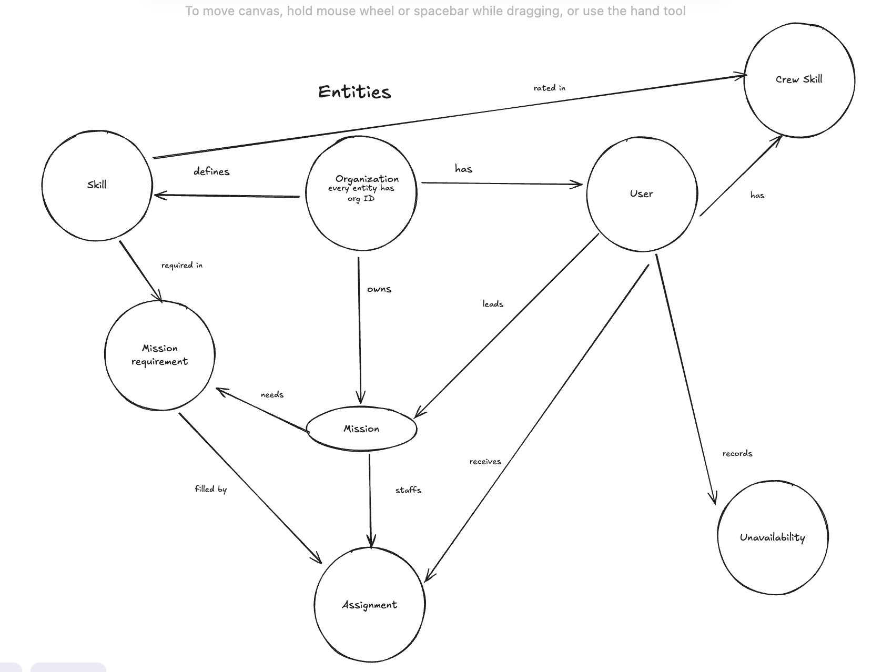
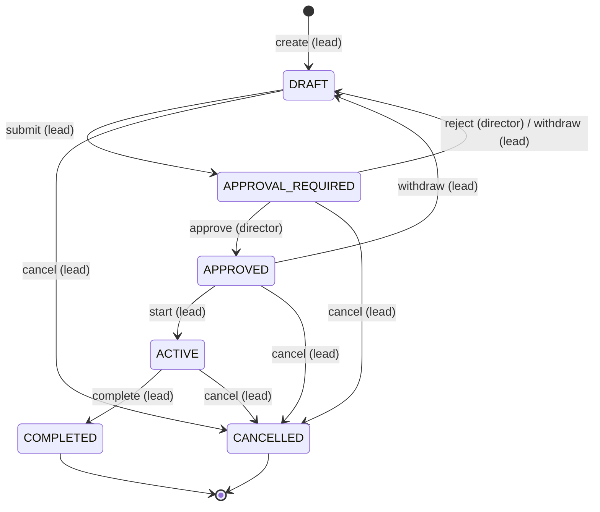
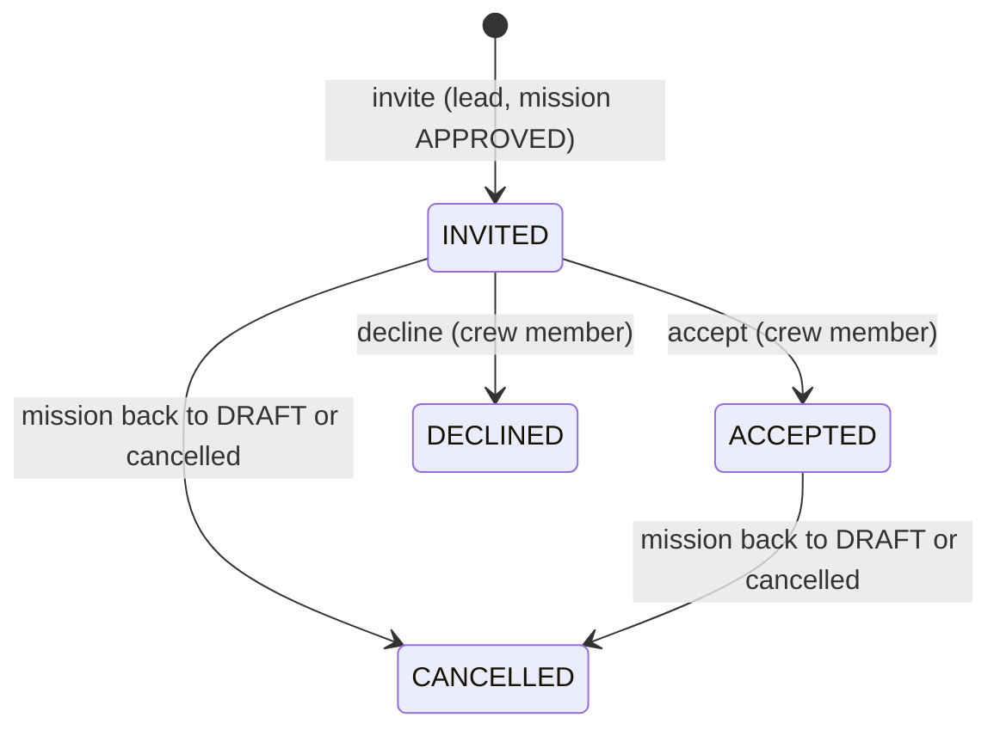

# Mission Control MVP v0

## Background
The customer is the operations team of an organization (org). An org can be a space agency or a private company.

Mission leads spend hours to cross-reference skill profiles, availability calendars and existing commitments. Mission staffing is the bottleneck. Mission Control finds qualified and available crew members for a mission and makes sure that they are not overloaded.

| User | Responsibility |
|------|----------------|
| Mission lead (power user) | Manages missions. Staffs them with qualified and available crew members. |
| Director | Approves or rejects missions. Oversees the org. Manages org settings (skills). |
| Crew member | Manages their profile (skills and availability). Accepts or declines assignments. |

## Requirements
### P0
P0 is the first version that is ready to pitch to a customer.

**Delivery**
1. A reviewer clones the GitHub repository and runs it locally in minutes. The repository contains setup instructions, demo seed data, this design document, the API and the CLI.
2. The repository contains evidence of verification: test output and a scripted CLI demo.
3. The seed data has 2 orgs and 2 directors in one org. It has enough crew members to show the matcher trade-offs: experts against closest fit, leave and workload.

**Auth and tenant**

4. Each org is a separate tenant with exclusive data access. The data-access layer and composite foreign keys enforce this.
5. Each user has one role: director, lead or crew member. The API enforces the role permissions.
6. A user logs in to the CLI as a seeded user (`mc login --user username`).
7. For a forbidden action, the CLI shows a clear error with the role and the rule.

**Mission lifecycle**

8. Each mission needs approval. The lead submits the mission to a director.
9. The director approves or rejects the mission. The approval view shows the matcher preview.
10. Crew members accept or decline assignments.
11. Deferred to P1: directors see the whole org (API and CLI). See P1 item 5.

**Crew and skills**

12. Crew members manage their skill profile via the CLI. They list, add, update and remove their own skills from the org catalogue, with a proficiency level.
13. Crew members manage their availability via the CLI. They list, add and remove their own unavailability.
14. Crew members see their own assignments with history (past, declined), their profile and the mission details. They accept or decline assignments.
15. Each org has its own set of skills. P0 seeds the skills. P1 adds skill editing.

**Matching**

16. The matcher suggests crew members for a mission. The inputs are skills, availability and workload.
17. The lead runs a read-only matcher preview in DRAFT to check that the mission can be staffed.
18. The lead invites crew members only when the mission is APPROVED.
19. Rematching fills only open slots. It never suggests a crew member who declined this mission.

**CLI**

20. The primary workflows run through the CLI. See [CLI](#cli).

**Quality**

21. Tests cover the happy path per workflow: lifecycle, matcher, invites and responses, crew profile.
22. Cross-org access checks make sure that resources of another org return 404.
23. A scripted end-to-end CLI demo runs create, match, submit, approve, invite, accept and decline. A crew member manages the own profile.

#### Build order
Each step ends with its happy path test and its cross-org check. Each step is one or more commits.

1. Skeleton: docker-compose Postgres, FastAPI app, Alembic, Typer entry point, README run steps.
2. Data model, first migration and seed data: 2 orgs, 2 directors in one org, leads, crew, skills, leave, existing assignments for workload.
3. Auth and tenant: `mc login`, JWT with `user_id`, per-request load of user, org and role, org-scoped data-access layer, RBAC error format.
4. Missions in DRAFT: create, edit, slots, list, show.
5. Matcher preview: filters, ranking, slot assignment. `mc missions match`.
6. Approval: submit, withdraw, approve, reject. No self approval, additional director flag, matcher preview in the approval view.
7. Staffing: invite, `mc assignments list / accept / decline`, double booking check, decliner exclusion on rematch.
8. Remaining transitions: withdraw from APPROVED to DRAFT, start (with guard), complete, cancel. Assignment cancellation. Deferred to P1.
9. Crew profile: `mc profile show`, skills, availability.
10. Org crew view: directors and leads list and show the crew members of the org (requirement 11). Leads see leave as "unavailable" without the reason. Deferred to P1.
11. Scripted end-to-end CLI demo and test results in the README.

The [Implementation status](#implementation-status) section at the end shows what the build covers.

### P1
P1 extends the MVP if time permits in this session.

1. Directors manage the org skill catalogue.
2. Mission audit logs.
3. Decision insights for the lead: why the matcher excluded a crew member.
4. Rank breakdown per suggestion: why a crew member is the best fit for the slot.
5. Directors see the whole org: all missions and all crew members (API and CLI). This is requirement 11, build step 10.
6. Remaining mission transitions: withdraw from APPROVED, start, complete, cancel (build step 8).
7. Short references for missions (`MSN-<n>`) and skills (`slug`) in the CLI. See [Short references](#short-references).

### P2
P2 is out of scope for this session.

| Area | Item |
|------|------|
| Auth and tenant | Noisy-neighbour protection and uneven org sizes |
| | Real IdP (OIDC), login and signup |
| | Postgres RLS as a second layer for reads |
| | User and role management |
| Mission lifecycle | Approval workflow customization |
| | Crew members withdraw after they accept |
| | Reject with comment, cancel with reason |
| | Reassign the lead of a mission |
| Crew and skills | Edit and archive skills |
| | Verification of self-assessed proficiency |
| Matching | Additional resource constraints |
| | Report of skill gaps and possible resolutions when no match exists |
| | Rest buffer between missions |
| | Mission priority |
| | Optimization for large orgs |
| Operations | CI/CD |
| | Scalability, observability, IaC, offline jobs |

## Tech stack
The API and the CLI use one language (Python). This keeps the stack small.

| Component | Choice | Reason |
|-----------|--------|--------|
| CLI | Typer, httpx, Rich | Typed commands, generated help, readable tables. The CLI calls the API and stores the token locally after login. |
| API | FastAPI, Pydantic | Typed API with generated OpenAPI docs. |
| Data access | SQLAlchemy, Alembic | Safe DB access with migrations. |
| Database | Postgres | |
| Auth | Local JWT login with seeded users | See [Authentication & Authorization](#authentication--authorization). |
| Orchestration | docker-compose | Runs the services and seeds the data locally. |

**Shared types.** A shared Pydantic package in the same repository holds the request and response types. The API and the CLI import the same types. The package depends only on Pydantic, not on FastAPI or SQLAlchemy. There is no generated OpenAPI client, so there is no regeneration step.

## Data model

Each entity has an `org_id`. See [Tenant isolation](#tenant-isolation).

### Conventions
- `id` is a UUID primary key. The API paths and the CLI use it. Users and slots also have [short references](#short-references).
- Each tenant table has `org_id NOT NULL`. Parent tables have `UNIQUE(org_id, id)` for composite foreign keys.
- Each table has `created_at` and `updated_at`. The tables below do not show them.
- Fields marked *(derived)* are not stored. The API computes them at query time.

### Organization
The tenant root.

| Field | Type | Notes |
|-------|------|-------|
| id | uuid | PK |
| name | text | |

### User

| Field | Type | Notes |
|-------|------|-------|
| id | uuid | PK |
| org_id | uuid | FK to organization |
| username | text | Globally unique. `mc login --user` uses it. |
| display_name | text | |
| role | enum | `DIRECTOR`, `LEAD`, `CREW`. One role per user. |

### Skill
The skill catalogue of the org.

| Field | Type | Notes |
|-------|------|-------|
| id | uuid | PK |
| org_id | uuid | FK to organization |
| name | text | `UNIQUE(org_id, name)` |
| description | text | Optional |

### CrewSkill
The skill profile of a crew member. It links a user to a skill.

| Field | Type | Notes |
|-------|------|-------|
| org_id | uuid | |
| user_id | uuid | `(org_id, user_id)` to user |
| skill_id | uuid | `(org_id, skill_id)` to skill |
| level | smallint | `CHECK` 1 to 5 |

- The PK is `(user_id, skill_id)`.
- The service layer checks that the user has the role `CREW`.

### Unavailability

| Field | Type | Notes |
|-------|------|-------|
| id | uuid | PK. `mc profile availability remove id` uses it. |
| org_id | uuid | |
| user_id | uuid | `(org_id, user_id)` to user |
| start_date | date | |
| end_date | date | `CHECK end_date >= start_date`. The range includes both dates. |
| reason | enum | Examples: `HOLIDAY`, `SICK`, `MEETING`. The API does not show the reason to leads. |

### Mission

| Field | Type | Notes |
|-------|------|-------|
| id | uuid | PK |
| org_id | uuid | |
| title | text | |
| description | text | Optional |
| lead_id | uuid | `(org_id, lead_id)` to user. The service layer checks the role `LEAD` or `DIRECTOR`. |
| status | enum | `DRAFT`, `APPROVAL_REQUIRED`, `APPROVED`, `ACTIVE`, `COMPLETED`, `CANCELLED` |
| start_date | date | |
| end_date | date | `CHECK end_date >= start_date` |
| approved_by | uuid | Optional. `(org_id, approved_by)` to user. A minimal audit trail until the P1 audit log. |
| approved_at | timestamptz | Optional. The API clears `approved_by` and `approved_at` when the lead withdraws the mission from APPROVED to DRAFT. |
| requires_additional_director | bool *(derived)* | True if the current role of the lead is `DIRECTOR`. Never stored. |

### MissionRequirement
A slot of a mission: one skill with a minimum level.

| Field | Type | Notes |
|-------|------|-------|
| id | uuid | PK |
| org_id | uuid | |
| mission_id | uuid | `(org_id, mission_id)` to mission |
| position | smallint | Partial unique index on `(mission_id, position) WHERE archived_at IS NULL`. A new slot can use the position of an archived slot. |
| skill_id | uuid | `(org_id, skill_id)` to skill |
| min_level | smallint | `CHECK` 1 to 5 |
| archived_at | timestamptz | Optional. Set when the lead deletes the slot. |

- The lead deletes a slot only in DRAFT. The API archives the slot and does not delete the row. Assignment history keeps its reference to the slot.
- Archived slots are not part of the mission. The matcher, the invite and the start guard ignore them.
- The table also has `UNIQUE(org_id, mission_id, id)`. The assignment references this key.

### Assignment

| Field | Type | Notes |
|-------|------|-------|
| id | uuid | PK |
| org_id | uuid | |
| mission_id | uuid | `(org_id, mission_id)` to mission |
| requirement_id | uuid | `(org_id, mission_id, requirement_id)` to mission_requirement. The slot belongs to the same mission. |
| user_id | uuid | `(org_id, user_id)` to user. The service layer checks the role `CREW`. |
| status | enum | `INVITED`, `ACCEPTED`, `DECLINED`, `CANCELLED` |
| responded_at | timestamptz | Optional |

- Partial unique index on `(mission_id, user_id) WHERE status IN (INVITED, ACCEPTED)`: one active assignment per crew member and mission.
- Partial unique index on `(requirement_id) WHERE status IN (INVITED, ACCEPTED)`: one active assignment per slot.
- The service layer prevents double booking with a row lock. See [Assignment states](#assignment-states).

### Derived values
The DB does not store these values. The API computes them at query time.

| Value | Source |
|-------|--------|
| Workload | Booked mission days of INVITED and ACCEPTED assignments in a time window before and after the mission. The window (example: 90 days) is a code constant. |
| Decliner exclusion | DECLINED assignments of the mission. The API never deletes them, because the matcher reads them. |
| Additional director flag | The current role of the mission lead |

## Mission lifecycle workflow
### Mission states

| State | Description |
|-------|-------------|
| DRAFT | The lead creates and edits the mission and its slots, and runs the matcher preview. If the lead is a director, the mission shows that it needs an additional director for approval. |
| APPROVAL_REQUIRED | The mission details are final. A director sees the matcher preview and approves or rejects. A rejection returns the mission to DRAFT without a comment. The lead can withdraw the mission to DRAFT. |
| APPROVED | The lead staffs the mission and invites crew members. To change details, the lead withdraws the mission to DRAFT. All INVITED and ACCEPTED assignments then become CANCELLED. The API clears `approved_by` and `approved_at`. |
| ACTIVE | The lead started the mission. Guard: each slot has an ACCEPTED assignment. |
| COMPLETED | The lead completed the mission. |
| CANCELLED | The lead cancelled the mission, without a reason. All states except COMPLETED can go to CANCELLED. All INVITED and ACCEPTED assignments become CANCELLED. |

**Built today.** The code has the transitions submit, withdraw (from APPROVAL_REQUIRED), approve and reject. Withdraw from APPROVED, start, complete and cancel are not built (build step 8). No code cancels assignments yet, because no built transition needs it.

**Rules**
- The lead can edit a mission only in DRAFT.
- Staffing changes need no new approval. Example: the lead replaces a crew member who declined.
- The code holds the allowed transitions as `action -> (from, to)`. The route of each action checks the actor. This is the extension point for approval workflow customization (P2).
- P0 uses one director approval. A later version can store approval configurations in the DB.
- Invites happen only after approval. This way, unfunded missions do not reserve scarce skills.
- There is no separate staffing state. The assignment states show the staffing progress of an APPROVED mission.

### Mission requirements
A mission has slots. A slot is one skill with a minimum proficiency level. A crew member fills a maximum of one slot per mission.

The lead deletes a slot only in DRAFT. The API archives the slot (soft delete), so the assignment history keeps its reference. The matcher, the invite and the start guard ignore archived slots. See [MissionRequirement](#missionrequirement).

### Assignment states

| State | Description |
|-------|-------------|
| INVITED | The lead invited the crew member. This is possible only when the mission is APPROVED. |
| ACCEPTED | The crew member accepted. |
| DECLINED | The crew member declined. The slot is open again and the lead runs the matcher again. The matcher never suggests this crew member for this mission again. The rematch in APPROVED is deferred (see [Deferred](#deferred)). Until then, the lead invites another crew member by name. |
| CANCELLED | The mission went back to DRAFT or the lead cancelled it. The crew member is available again. |

The API checks the invite in this order. The first failed check gives the error.

1. The mission exists in the org of the lead (404).
2. The lead owns the mission (403).
3. The mission is APPROVED (409).
4. The slot exists (422).
5. The crew member exists (422).
6. The user has the CREW role (422).
7. The slot has no INVITED or ACCEPTED assignment (409).
8. The crew member has no INVITED or ACCEPTED assignment on this mission (409).
9. The crew member did not decline this mission (409).
10. The crew member has the skill at the minimum level (409).
11. The crew member has no leave that overlaps the mission (409).
12. The crew member has no double booking (409).

When more than one leave entry or mission overlaps, the error names the one with the earliest start date.

The API checks for double booking at invite and at accept. The service locks the user row of the crew member (`SELECT ... FOR UPDATE`). In the same transaction, it checks for date overlap with INVITED and ACCEPTED assignments. A DB constraint is not possible, because the assignment does not hold the mission dates.

Accept and decline check in this order: the mission exists in the org (404), the crew member has an assignment on the mission (404), the assignment is INVITED (409). Accept then checks double booking with the other missions (409). Accept does not check the skill or the leave again.

### Profile conflicts
The API rejects a crew profile change that conflicts with an INVITED or ACCEPTED assignment. The error response names the conflict.

| Change | Conflict |
|--------|----------|
| Add unavailability | The unavailability overlaps the dates of the mission. |
| Lower a skill level | The new level is below the minimum level of the slot. |
| Remove a skill | The slot requires the skill. |

## Authentication & Authorization
### Authentication
- A user logs in with a seeded user: `mc login --user username`. The API issues a local JWT.
- The JWT carries only the `user_id`. The API loads the org and the role from the DB on each request.
- Role changes and revocation apply immediately. The cost is one primary key lookup per request.

### Roles
Each user has one role. The hierarchy is Director > Lead: a director can do all that a lead can do. Crew members are not part of this hierarchy.

A director acts only on their own missions. A director cannot act on the mission of another lead. The only exception is approve or reject.

| Action | Director | Lead | Crew member |
|--------|----------|------|-------------|
| Create and edit own missions (DRAFT only) | Yes | Yes | No |
| Run the matcher on own missions (preview in DRAFT. The APPROVED preview is deferred.) | Yes | Yes | No |
| Invite crew to own missions (APPROVED only) | Yes | Yes | No |
| Approve or reject missions | Yes, not own missions | No | No |
| View all missions and crew of the org (missions built. The crew view is not built.) | Yes | Yes, leave shows as "unavailable" without reason | No |
| Edit org settings (skills) (P1, not built) | Yes | No | No |
| View own assignments, history and mission details | No | No | Yes |
| Accept or decline own assignments | No | No | Yes |
| View and edit own profile: skills and unavailability | No | No | Yes |

### Approval rules
- A mission lead never approves their own mission.
- A director who leads a mission needs a second director for approval.
- The API and the CLI flag this at mission creation: the mission needs an additional director.
- The API derives the flag from the current role of the lead. The DB never stores the flag.

### Assignment rules
- Only crew members can be assigned to missions. A lead or a director is never a crew member.
- The service layer checks this rule. The composite foreign keys do not cover it.

### Error format
The API enforces permissions. For a forbidden action in the own org, the API returns 403 with the role and the rule. The CLI shows both. See [Tenant isolation](#tenant-isolation) for 404 rules.

## Tenant isolation
Each org is a tenant. Data must never leak across tenants.

- Each user belongs to one org.
- Each query goes through an org-scoped data-access layer. The layer compares the org of the user with the org of the data.
- The layer looks up each referenced ID (for example `skill_id`, `crew_id`) with an org filter. A cross-org ID returns no data.

### Composite foreign keys
Composite foreign keys are a second layer for writes. The DB rejects cross-org links even if the data-access layer has a bug.

- Each tenant table has `org_id`. Parent tables have `UNIQUE(org_id, id)`.
- Child tables reference `(org_id, x_id) -> parent(org_id, id)`:

| Child | Parent |
|-------|--------|
| assignment | mission, user |
| assignment `(org_id, mission_id, requirement_id)` | mission_requirement `(org_id, mission_id, id)`, so the slot belongs to the same mission |
| mission_requirement | mission, skill |
| crew_skill | user, skill |
| unavailability | user |
| mission.lead_id | user |
| mission.approved_by | user |

Composite foreign keys do not protect reads. Reads rely only on the data-access layer. Postgres RLS as a second layer for reads is P2.

### Error rules

| Case | Response |
|------|----------|
| The resource does not exist | 404 |
| The resource exists in another org | 404. The response never shows that the resource exists. |
| The resource exists in the own org, but the role has no access | 403 with role and rule |

### Verification
The happy path tests include cross-org access checks for each build step.

## Matching engine
The matcher fills each slot with one crew member. A slot is one skill with a minimum level.

### Filters
The matcher includes a crew member in the selection set only if all conditions are true:
- The crew member is in the same org.
- The crew member has the skill at the minimum level or higher.
- The crew member has no unavailability, INVITED or ACCEPTED assignment in the mission timeframe.
- The crew member has not declined this mission.

### Ranking
The matcher ranks the candidates of a slot in this strict order. A later rule applies only at a full tie of the earlier rules.
1. **Proficiency is closest to the minimum (gap).** The gap is `level - min_level`. Experts stay free for missions with higher proficiency requirements.
2. **Scarcity is lower.** Scarcity is the max of `1 / holders` over the other skills of the crew member, without the slot skill. `holders` counts the CREW members of the org with the skill at any level. A crew member with no other skill has scarcity 0. The matcher keeps the holders of a rare skill free.
3. **Workload is lower.** Workload is the number of booked mission days (INVITED and ACCEPTED) in a window of 90 days before and after the mission. Workload is only a tie breaker. A workload cap is P2.
4. **The username is first in alphabetical order.** This rule makes each result deterministic.

### Slot assignment
- The matcher assigns all slots together, not one by one.
- scipy `linear_sum_assignment` solves a slots x candidates cost matrix. A big cost marks the ineligible pairs, so the solver fills the maximum number of slots first.
- Rematching fills only open slots. An open slot has no INVITED or ACCEPTED assignment.

### Availability
Crew members manage unavailable time slots, not available periods. Examples are holiday leave, sick leave and internal meetings. The time slots use dates only.

### Deferred
- P1: rank breakdown per suggestion, and reasons for excluded crew members.
- P1: directors manage the skill catalogue, mission audit logs, and short references for missions and skills. None is built.
- P0, deferred: rematch of open slots (requirement 19, build step 7). The design keeps this rule. The build deferred it because of time: slice 5 of the staffing plan is not built. The deferred slice lets the matcher preview run on an APPROVED mission and list only open slots. Today the preview runs only in DRAFT, and the permission row "Run the matcher on own missions" reads "preview in DRAFT". The lead invites by name in APPROVED. The decliner filter of the matcher already works, so the rematch needs no schema or API change.
- P2: gap report when no match exists, resource constraints, rest buffer, mission priority.

## CLI
The CLI command is `mc`. It calls the API and stores the token locally after login.

### Commands v0

| Workflow | Command |
|----------|---------|
| Login | `mc login --user username`, `mc logout` |
| Missions list | `mc missions list` |
| Mission detail | `mc missions show <mission-id>` |
| Mission lifecycle | `mc missions create\|edit\|submit\|withdraw\|approve\|reject\|cancel\|start\|complete` |
| Matcher | `mc missions match <mission-id>` |
| Invite (APPROVED only) | `mc missions invite <mission-id> --slot 1 --crew username` |
| My assignments (crew), current and history | `mc assignments list` |
| Respond to assignment | `mc assignments accept\|decline <mission-id>` |
| My profile (crew) | `mc profile show` |
| Skills | `mc profile skills set <skill-id> --level n`, `mc profile skills remove <skill-id>` |
| Availability | `mc profile availability list`, `add --from date --to date`, `remove id` |

The CLI shows table views.

**Built today.** All commands above work, except these:
- `mc missions cancel|start|complete` are not built (build step 8).
- `mc crew list` and `mc crew show <username>` are not built (build step 10). The command table above does not list them yet.
- `mc missions show` prints no matcher preview. Requirement 9 needs it for APPROVAL_REQUIRED.
- `mc missions match` works only on DRAFT missions.

The CLI has these commands that the table does not list: `mc health`, `mc whoami`, `mc skills list`, `mc missions slots add|remove <mission-id>`. `mc missions edit` takes the changed fields as options. The slot commands use the slot position.

### Short references
The API paths use UUIDs. The CLI uses UUIDs for missions and skills. Each entity in an API response contains the `id` and, if it has one, the short reference. A DB unique constraint enforces each short reference.

| Resource | Key | Constraint |
|----------|-----|------------|
| User | `username` | Globally unique, because `mc login --user` has no org context. The CLI references crew members by username. |
| Slot | Position in the mission (1, 2, 3) | Partial unique index on `(mission_id, position) WHERE archived_at IS NULL`. Partial unique index on assignment `(requirement_id) WHERE status IN (INVITED, ACCEPTED)`: one active assignment per slot. |
| Assignment | Mission UUID | Partial unique index: one INVITED or ACCEPTED assignment per `(mission_id, user_id)` |

#### P1: Mission and skill short references
P1 adds short references for missions and skills in the CLI.

| Resource | Key | Constraint |
|----------|-----|------------|
| Mission | `MSN-<n>` per org | `UNIQUE(org_id, number)`. See below. |
| Skill | `slug` | `UNIQUE(org_id, slug)`. The API rejects a duplicate slug with a clear error. There is no automatic suffix. |

The API gets the next mission number with `UPDATE org SET mission_seq = mission_seq + 1 ... RETURNING` in the same transaction. The row lock serializes concurrent creates, so numbers do not collide.

## Changes

| Date | Change | Reason |
|------|--------|--------|
| 2026-10-11 | Add build step 10, org crew view. The demo becomes step 11. | Requirement 11 had no build step. Step 9 covers only the own profile of a crew member. |
| 2026-10-11 | Decide the matcher cost order, the scarcity rule and the solver. | Build step 5 had to evaluate the scarcity term and scipy. |
| 2026-10-11 | Key the transition table by action. | Withdraw and reject both go from APPROVAL_REQUIRED to DRAFT, with different actors. |
| 2026-10-11 | Defer requirement 11 and build steps 8 and 10 to P1. Narrow requirement 23 to the demo of create, match, submit, approve, invite, accept and decline. | The time is short. The demo shows the core journey and the crew profile. |
| 2026-10-11 | Add the build status, the not built items and the known gaps. | The design had no record of what the build covers. The approval view preview is not built. Build steps 8 and 10 are deferred to P1. The step 11 demo is in progress. |
| 2026-10-11 | Defer the matcher preview on APPROVED missions (rematch of open slots). Build step 7 ships invite, accept, decline and the double booking check without it. | The lead can invite by name. The rematch needs no schema or API change and follows later. |

## Implementation status
### Build status
Status on `develop` at commit `1e183de`. The design above stays the target. This table shows what the code does today.

| Step | Status | Built | Not built |
|------|--------|-------|-----------|
| 1 Skeleton | Built | | |
| 2 Data model and seed | Built | One migration. `mc-seed` loads 2 orgs, 20 users, skills, leave, 5 missions and assignments. | |
| 3 Auth and tenant | Built | `mc login`, `whoami`, `logout`. JWT with `user_id`. Org-scoped data-access layer. 403 format. Info logging. | |
| 4 Missions in DRAFT | Built | Create, edit, slots (add, remove by position), list, show. `GET /skills` and `mc skills list`. | |
| 5 Matcher preview | Built | Filters, ranking (gap, scarcity, workload, username), scipy slot assignment. `mc missions match`. | The preview runs only in DRAFT. |
| 6 Approval | Partly built | Submit, withdraw from APPROVAL_REQUIRED, approve, reject. No self approval. The additional director flag. `approved_by` and `approved_at` in the mission view. | The matcher preview in the approval view (requirement 9). Slice 3 of the approval plan is not built. `mc missions show` prints no preview. |
| 7 Staffing | Partly built | Invite with all 12 checks. `mc assignments list`, `accept`, `decline`. Double booking check with a row lock. Decliner filter in the matcher. | The rematch of open slots in APPROVED (requirement 19). See [Deferred](#deferred). |
| 8 Remaining transitions | Deferred to P1 | | Withdraw from APPROVED. Start with its guard. Complete. Cancel. Cancellation of assignments. The transition table has only the four actions of step 6. |
| 9 Crew profile | Built | `mc profile show`, skills (list, set, remove), availability (list, add, remove). Profile conflicts (409). | |
| 10 Org crew view | Deferred to P1 | `GET /users/{user_id}` only. Crew members see only their own record. | `GET /crew`, `GET /crew/{user_id}`, `mc crew list`, `mc crew show`. Directors and leads cannot list or show crew members (requirement 11). The mission list already shows all missions of the org. |
| 11 Demo and test results | In progress | The README has run steps, the seed table and the test command. `scripts/demo.sh` and a README Demo section exist as uncommitted changes. The demo covers profile, create, match, submit, approve, invite, accept and decline. | Test results in the README (requirement 2). A commit of the demo. The demo has no rematch, no 403 or 404 check, no start, complete or cancel, and no crew view. |

No P1 item is built. P2 is out of scope.

P0 requirements not met: 2 (test results in the README), 9 (preview in the approval view) and 19 (rematch). Requirement 11 is deferred to P1. Requirement 23 is narrowed to the demo of step 11, which is in progress.

### Open and deferred items
- Open: matcher preview in the approval view (requirement 9, build step 6). `GET /missions/{id}` and `mc missions show` do not return the preview. Slice 3 of the `mission-approval` plan has the design.
- Open: test results in the README (requirement 2).
- Open: commit of the demo (`scripts/demo.sh`, README). The `readme-demo` plan has one slice, started, not complete.
- Deferred to P0 later: rematch of open slots (requirement 19). See [Deferred](#deferred).
- Deferred to P1: remaining transitions and assignment cancellation (build step 8). No plan exists.
- Deferred to P1: org crew view (requirement 11, build step 10). The `org-crew-view` plan has three slices, none built.

### Known gaps in the built code
The slice reviews list these items. None blocks a happy path.
- Two concurrent `PUT /profile/skills/{id}` calls for the same new skill can give a 500 (`IntegrityError`).
- A body validation error (422) writes no log line. This applies to the mission routes and to `POST /profile/unavailability`.
- Accept and decline have no test for info-level logging, by decision. The code logs each state change and rejection. Older `caplog` tests of invite, approval and auth still exist.
- `mc missions approve` and `reject` have no CLI test for a 409.
